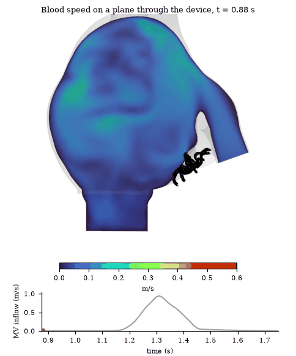
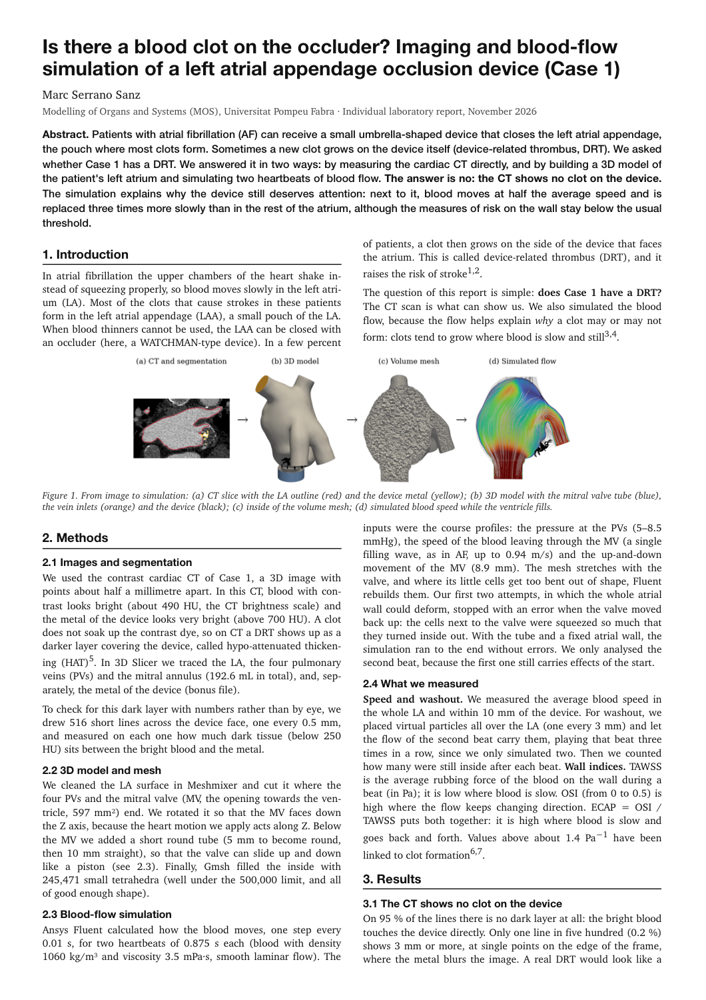
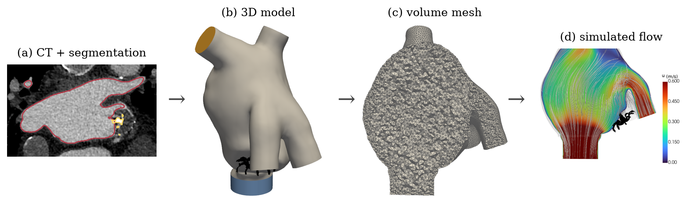
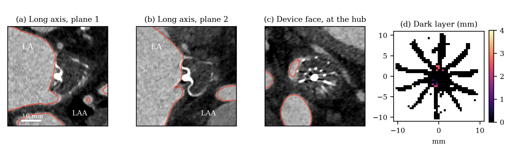
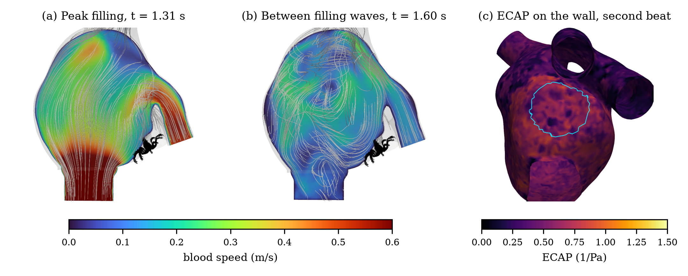
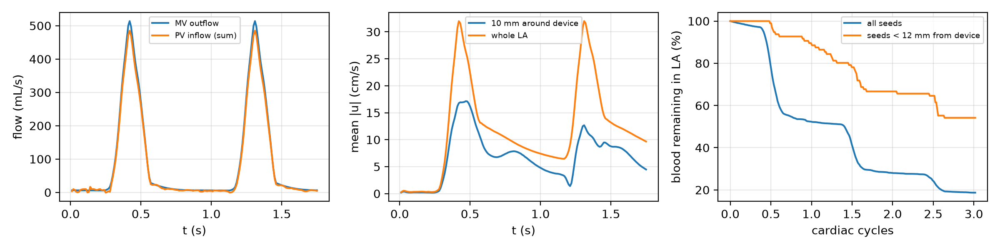
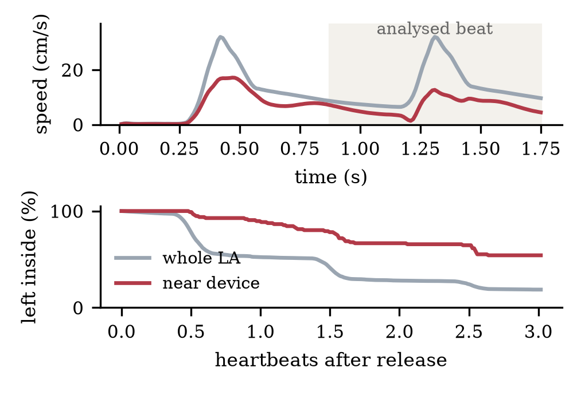
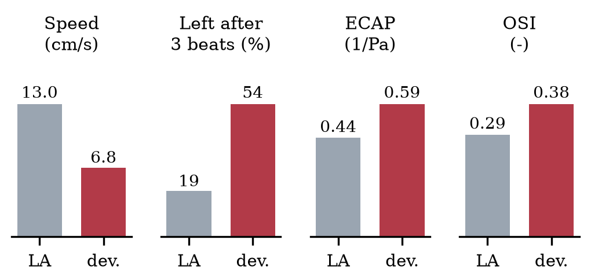
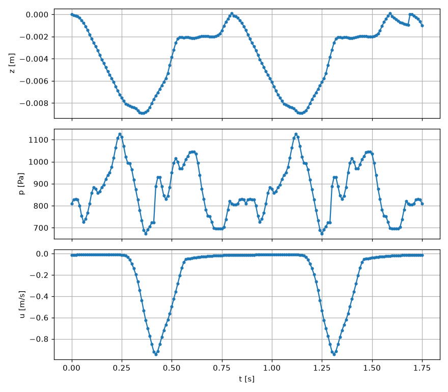

<h1 align="center">Is there a blood clot on the occluder?</h1>
<p align="center"><b>CT imaging and blood-flow simulation of a left atrial appendage occlusion device (Case 1)</b><br>
Marc Serrano Sanz · Modelling of Organs and Systems (MOS), Universitat Pompeu Fabra · 2026/27</p>

<p align="center">
  
  
  
  
  
</p>

<p align="center">
  
</p>
<p align="center"><i>Blood speed on a plane through the occluder during the second simulated heartbeat. The black dots are the device. The curve underneath is the blood entering the left atrium through the mitral valve.</i></p>

---

## The short version

A patient with atrial fibrillation received a small umbrella-shaped **occluder** that closes the *left atrial appendage*, the pouch where most clots form. Sometimes a new clot grows on the device itself (**device-related thrombus, DRT**). The question of this project is simple: **does Case 1 have one?**

We answered it in two ways, starting from the same cardiac CT:

1. **Look at the CT directly** and measure whether a dark (clot-like) layer covers the device.
2. **Build a 3D model of the patient's left atrium and simulate two heartbeats of blood flow**, to see whether the device sits in a place where clots tend to form.

> ### Answer: **no, there is no device-related thrombus in Case 1.**
> The CT decides it: bright, contrast-filled blood touches the device everywhere. The simulation adds context: the device sits in the quietest corner of the atrium (blood there moves at about half the average speed and is replaced about three times more slowly), but the risk indicators stay below the usual threshold. In simple terms: **no clot today, and a low-to-moderate risk.**

| | whole left atrium | next to the device |
|---|:---:|:---:|
| Average blood speed (second beat) | 13.0 cm/s | **6.8 cm/s** |
| Blood still inside after 3 beats | 19 % | **54 %** |
| Wall shear oscillation (OSI) | 0.29 | **0.38** |
| Clot-risk index (ECAP) | 0.44 Pa⁻¹ | **0.59 Pa⁻¹** |

ECAP stays **below the 1.4 Pa⁻¹ risk threshold at every point of the wall**.

### Read the report

The two-page paper-style report (plus references) is here: **[`report/Case1_DRT_report.pdf`](report/Case1_DRT_report.pdf)**. This README tells the same story with more of the engineering behind it.

<p align="center">
  <a href="report/Case1_DRT_report.pdf"></a>
</p>

---

## From image to simulation

<p align="center"></p>

| Step | What we did | Tool |
|---|---|---|
| **1. CT** | Contrast cardiac CT, voxels of 0.45 × 0.45 × 0.3 mm. Contrast blood is bright (about 490 HU), the nitinol device is very bright (over 700 HU). | pydicom |
| **2. Segmentation** | Left atrium, 4 pulmonary veins and mitral annulus (192.6 mL), the device separately. | 3D Slicer |
| **3. Surface** | Cut the veins and the mitral valve (MV, 597 mm²), clean the triangles (genus 0, no self-intersections), rotate so the **MV normal is −Z** because the heart motion we impose acts along Z. | Meshmixer, trimesh, pymeshlab |
| **4. Valve tube** | Extend the MV with a 5 mm transition into a circle and a 10 mm straight tube, so the valve can slide like a piston (see [why](#the-hard-part-making-the-mesh-move)). | `scripts/extend_mv_cyl.py` |
| **5. Volume mesh** | 245,471 tetrahedra (limit 500,000), worst skewness 0.91, written as `.bdf` and as a Fluent `.msh` with named zones. | Gmsh + Netgen, `scripts/fluent_msh.py` |
| **6. Simulation** | Laminar blood (1060 kg/m³, 3.5 mPa·s), 2 heartbeats of 0.875 s, Δt = 0.01 s, coupled solver, 2nd order. Pressure at the veins, velocity and up-and-down motion at the valve, all from the course profiles. | Ansys Fluent 2026 R1 |
| **7. Analysis** | Speed, washout, wall shear indices, figures, animation. | Python, PyVista, ParaView format |

---

## What the CT shows

<p align="center"></p>

A clot does not soak up the contrast dye, so on CT a DRT looks like a **dark layer covering the device** (*hypo-attenuated thickening*, HAT). To check this with numbers and not by eye, we drew **516 short lines across the device face**, one every 0.5 mm, and measured how much dark tissue (below 250 HU) lies between the bright blood and the metal.

- **Median thickness of the dark layer: 0 mm.** On 95 % of the lines there is no dark layer at all.
- Only 0.2 % of the lines reach 3 mm, at isolated points on the edge of the frame where the metal blurs the image (largest value 4.3 mm). A real DRT would look like a continuous cap over the hub.
- The appendage behind the device is completely dark (no contrast), so **the device closes it fully**, without a leak.

---

## What the simulation shows

### Is the simulated flow realistic?

<p align="center"></p>

- The two beats are almost identical (peak flow through the MV of **500 and 514 mL/s**), each beat moves **82 mL**, and the atrial volume changes only between 190.7 and 196.1 mL. The blood entering through the veins matches the blood leaving through the valve.
- When the ventricle fills, a strong stream crosses the atrium towards the valve. Between filling waves the blood in the body of the atrium turns slowly in a large swirl.

<p align="center"></p>

### The device sits in a slow region

<table>
<tr>
<td width="50%"></td>
<td width="50%"><br><sub>LA = whole left atrium, dev. = within 10–12 mm of the device.</sub></td>
</tr>
</table>

- **Speed.** Next to the device blood moves at about half the average speed of the atrium.
- **Washout.** We released virtual particles all over the atrium (one every 3 mm) and let the flow of the second beat carry them, playing that beat three times in a row since we only simulated two. After three beats **54 %** of the blood that started next to the device is still there, against **19 %** for the whole atrium.
- **Wall.** TAWSS is the average rubbing force of blood on the wall; OSI says how much the flow changes direction; **ECAP = OSI / TAWSS** is high where blood is slow and goes back and forth. Around the device the flow oscillates more and ECAP is higher, but **nowhere does it reach 1.4 Pa⁻¹**, the value that has been linked to clot formation ([Di Achille et al., 2014](#references)).

### Conclusion and limitations

No clot today and a low-to-moderate risk, which supports keeping the usual treatment and the planned follow-up scan. Keep in mind: the atrial wall was kept still (only the valve moves), the boundary profiles are generic and not measured in this patient, blood was treated as a simple fluid, only two beats were simulated on one mesh, and the CT is a single picture in time. The ECAP threshold was first defined for aortic aneurysms, so **the simulation compares regions, and the CT is the evidence for a clot.**

---

## The hard part: making the mesh move

The valve plane moves **8.9 mm up and down** every beat, and the blood mesh has to stretch and be rebuilt around it. This is where most of the work went.

<p align="center"></p>

| Run | Setup | What happened |
|---|---|---|
| **1** | Atrial wall *deforming*, Δt = 0.01 s | Stopped at **t = 0.51 s**: `Update-Dynamic-Mesh failed. Negative cell volume detected.` |
| **2** | + 10 mm straight extension below the valve, Δt = 0.005 s, stronger smoothing | Same error, now at t ≈ 0.45 s. |
| **1b** | Restart with a smaller time step, stronger smoothing and stricter remeshing limits | Same error at the same moment. |
| **3** | **Valve tube declared as a *cylinder*, atrial wall stationary**, Δt = 0.01 s | **Ran through both beats without errors.** |

**Why it failed.** With the wall set to *deforming, faceted*, Fluent keeps projecting the moving wall points back onto the original surface. That surface ends where the valve starts, but the valve travels 8.9 mm *beyond* it. The wall points next to the valve rim could not follow, piled up, and the cells there turned inside out when the valve moved back up. Looking at the mesh just before the crash showed every badly distorted cell sitting on the valve rim.

**The fix.** The valve now moves inside a straight circular tube that Fluent knows is an infinite cylinder, so its points can always be placed correctly, like a piston in a cylinder. The rest of the atrial wall does not move.

**About the final data.** The cloud session that ran Fluent was shut down several times, so the 175 time steps come from three segments, restarted from autosaved case and data files: steps 1–50, 51–120 and 121–175. Autosaves were set to every 10 steps afterwards. The time steps, the setup and the mesh are the same in all segments ([`fluent/case001_setup_final.jou`](fluent/case001_setup_final.jou)).

---

## Repository

```
.
├── report/
│   ├── Case1_DRT_report.pdf        the final two-page report (+ references)
│   └── build_paper.py              builds the report (HTML → PDF) in three styles from one text
├── figures/                        figures of the report and this README (+ the animation)
├── fluent/
│   └── case001_setup_final.jou     the complete Fluent setup as a journal (models, boundary
│                                   conditions, dynamic mesh, solver, EnSight export)
├── data/bc_original/               the three boundary-condition profiles given by the course
└── scripts/
    ├── ct_io.py                    DICOM → numpy volume (LPS mm)
    ├── drt_imaging.py              the 516 lines: dark layer on the device (Figure above)
    ├── build_surface_marc.py       our Meshmixer surface → cleaned, labelled, Z-aligned surface
    ├── build_surface.py            alternative surface straight from the segmentation (fallback)
    ├── extend_mv.py / extend_mv_cyl.py   valve extension (straight / circular tube)
    ├── build_volume.py             Gmsh tetrahedra + quality checks + .bdf + Fluent .msh
    ├── fluent_msh.py               our own writer for the Fluent ASCII mesh format
    ├── postprocess.py              flows, volumes, speeds, TAWSS / OSI / ECAP from the EnSight export
    ├── washout.py                  virtual particles carried by the flow (washout)
    ├── ens_frames.py, write_encas.py   helpers for the EnSight files
    ├── make_figures.py, make_paper_figures.py, make_animation.py   figures and the GIF above
    └── make_deliverables.py        files of the course hand-in
```

### What is not here, and why

- **The CT and everything derived from it** (segmentation, surface and volume meshes, device model). The CT case is course material that is not redistributed, so the repository ships the code, the figures and the report only.
- **Solver output** (the EnSight results, about 0.8 GB, and the Fluent case and data files). These were handed in separately for visualisation in ParaView.

### Run order

The scripts are a documented record of the pipeline rather than a one-command rebuild: they expect the CT and a few intermediate arrays (`ct.npy`, the segmentation, …) that are not in the repository. Paths are set with environment variables (`CT_DIR`, `MESHMIXER_STL`, `SP` for the scratch folder).

```bash
pip install numpy scipy pydicom pynrrd trimesh pymeshlab gmsh meshio pyvista matplotlib pillow

python scripts/drt_imaging.py                                   # CT: dark layer on the device
python scripts/build_surface_marc.py                            # surface, labelled zones, Z-aligned
python scripts/extend_mv_cyl.py 5 15 1.25 data/derived data/derived_cyl   # valve tube
OUTDIR=data/derived_cyl python scripts/build_volume.py 1.8 v3   # tetrahedra, .bdf, Fluent .msh
# Fluent 2025R2 or newer: read fluent/case001_setup_final.jou (edit the Z:/MOS/ paths)
python scripts/postprocess.py <run_dir> 0.875                   # flows, TAWSS, OSI, ECAP
python scripts/washout.py <run_dir> 0.875 3 3                   # washout, 3 beats, 3 mm seeds
python scripts/make_figures.py <run_dir> 1.31 1.60 && python scripts/make_paper_figures.py <run_dir>
python report/build_paper.py                                    # report (print the HTML to PDF)
```

---

## References

1. Dukkipati SR, Kar S, Holmes DR, et al. Device-related thrombus after left atrial appendage closure: incidence, predictors, and outcomes. *Circulation* 138, 874–885 (2018).
2. Simard T, Jung RG, Lehenbauer K, et al. Predictors of device-related thrombus following percutaneous left atrial appendage occlusion. *J Am Coll Cardiol* 78, 297–313 (2021).
3. Mill J, Olivares AL, Arzamendi D, et al. Impact of flow dynamics on device-related thrombosis after left atrial appendage occlusion. *Can J Cardiol* 36, 968.e13–968.e14 (2020).
4. Aguado AM, Olivares AL, Yagüe C, et al. In silico optimization of left atrial appendage occluder implantation using interactive and modeling tools. *Front Physiol* 10, 237 (2019).
5. Korsholm K, Berti S, Iriart X, et al. Expert recommendations on cardiac computed tomography for planning transcatheter left atrial appendage occlusion. *JACC Cardiovasc Interv* 13, 277–292 (2020).
6. Di Achille P, Tellides G, Figueroa CA, Humphrey JD. A haemodynamic predictor of intraluminal thrombus formation in abdominal aortic aneurysms. *Proc R Soc A* 470, 20140163 (2014).
7. Mill J, Agudelo V, Olivares AL, et al. Sensitivity analysis of in silico fluid simulations to predict thrombus formation after left atrial appendage occlusion. *Mathematics* 9, 2304 (2021).

<sub>Individual laboratory report for *Modelling of Organs and Systems*, Universitat Pompeu Fabra, 2026/27. The boundary-condition profiles are course material.</sub>
